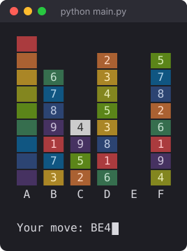

# Solitaire-Based Game

[](https://github.com/raudhahabas/Solitaire-Based-Game/actions/workflows/tests.yml)


A colourful solitaire-style puzzle game that runs in the terminal, written in pure Python with no third-party libraries.

**[▶ Play it in your browser](https://raudhahabas.github.io/Solitaire-Based-Game/)**: no install needed, and it has an on-screen keypad for phones.

<p align="center">
  
</p>

## About

I first wrote this game for a university Python programming module, then came back to it to turn it into a proper project. In the second pass I:

- **split the code into modules** so the game rules, the display and the input loop are separate and each can be tested alone
- **fixed bugs** in the original: undo could corrupt earlier moves, empty input crashed the game, and cards could be pulled out of finished stacks
- **wrote 26 unit tests** that cover every rule, and set up **GitHub Actions** to run them on Python 3.10 to 3.13
- **made the game easier to play** with clear error messages, an in-game help screen, a quit command, and a `--seed` option for repeatable deals
- **ported it to the web** as a single HTML/JavaScript page hosted on GitHub Pages. It uses the same rules, explains why a move isn't allowed, and only enables the keys that make sense at each point

## How to play

There are 36 cards: four copies each of the numbers **1 to 9**. They're shuffled and dealt into six stacks, **A** to **F**. Each number has its own colour.

**Goal:** sort the cards into four stacks that each run from **9 down to 1**. A finished stack turns into a solid colour bar and is locked.

**Rules**

- You can move a card onto a card that is exactly **one higher** (a 5 onto a 6), or onto an **empty** stack.
- You can move several cards together if they form a **descending run** (like 7-6-5) and the bottom card of the run fits where it lands.
- You can also drop a **single card anywhere**, but the stack it lands on becomes **blocked**: its top card turns grey and nothing can go on it until that card is moved away.

**Controls**

| Input | Action |
|-------|--------|
| `AB`  | Move the top card of stack A onto stack B |
| `AB3` | Move the top 3 cards of stack A onto stack B |
| `U`   | Undo the last move (as many times as you like) |
| `R`   | Deal a new game |
| `H`   | Show the rules |
| `Q`   | Quit |

Input is case-insensitive.

## Getting started

You need Python 3.10 or newer. Nothing else needs installing.

```bash
git clone https://github.com/raudhahabas/Solitaire-Based-Game.git
cd Solitaire-Based-Game
python main.py
```

To get the same deal every time, for example to practise one puzzle, pass a seed:

```bash
python main.py --seed 42
```

The colours use 24-bit ANSI codes. They work in macOS Terminal, iTerm2, Windows Terminal and most Linux terminals.

## Project structure

```
solitaire/
├── game.py      # Game rules: dealing, parsing input, validating and applying moves
├── display.py   # Draws the board as coloured terminal text
└── cli.py       # Game loop: reads input, keeps undo history, prints messages
tests/
├── test_game.py
└── test_display.py
docs/
├── index.html   # Browser version (served by GitHub Pages)
└── screenshot.svg
main.py          # Entry point (python main.py)
```

## Design notes

- **The rules are pure functions.** `game.py` never prints or reads input. Each move is checked by `is_valid_move(state, move)`, and `apply_move` **returns a new state** instead of changing the old one. Because of this, the rules are easy to test, and they could be reused by a GUI or a web front end without changes.
- **Undo is a stack of past states.** Since moves never change an old state, undo just goes back to the previous saved board. This is also what fixed the original undo bug, where the history and the live board shared data.
- **Typed data.** The board is a `GameState` dataclass, and moves are a `Move` named tuple with type hints. This makes the code easier to read than passing raw dicts and tuples around.

## Running the tests

```bash
python -m unittest discover -s tests -v
```
